<div align="center">

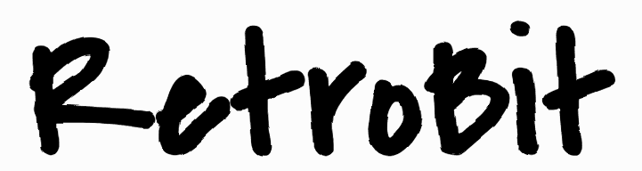

### Uma ferramenta de desenho onde cada traço fica *vivo*.

Desenhe com canetas, pincéis e spray, e veja o desenho tremer como num desenho animado antigo. Depois, exporte tudo como um **GIF animado**.

<br>


[**Como usar**](#como-usar) ·
[**Funcionalidades**](#funcionalidades) ·
[**Atalhos**](#atalhos) ·
[**Por dentro do código**](#codigo)

<br>

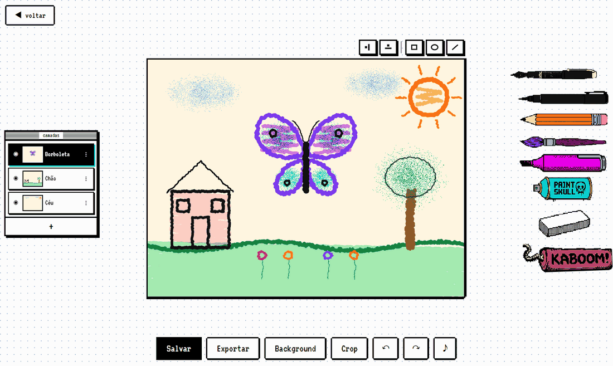

</div>

<br>

## ✏️ O que é o RetroBit?

O RetroBit é um programa de desenho que roda **direto no navegador**. Não precisa instalar nada e não precisa de internet depois de aberto.

O que o deixa diferente é o **traço tremido**: tudo o que você desenha fica se mexendo de leve, sem parar, como nos desenhos feitos à mão em que cada quadro é redesenhado. O visual lembra os computadores dos anos 80, com fonte pixelada, janelas em preto e branco e sons de videogame antigo.

<div align="center">
  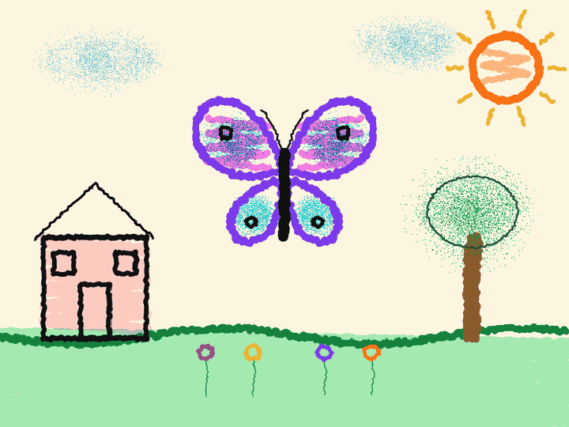
  <br><sub>Nada de filtro: cada traço é redesenhado com um pequeno tremor 12 vezes por segundo.</sub>
</div>

<br>

<a id="como-usar"></a>

## 🚀 Como abrir no seu computador

O RetroBit é só um site, sem nada para instalar ou compilar. Você só precisa de um **servidor local**, porque o navegador não carrega os arquivos do programa se você der dois cliques no `index.html`.

**1. Baixe o projeto**

```bash
git clone https://github.com/Nickvtj/CyberPaint.git
cd CyberPaint
```

> Sem Git? No GitHub, clique em **Code → Download ZIP** e descompacte.

**2. Ligue um servidor local** (escolha **uma** opção)

| Você tem… | Faça isto |
| :-- | :-- |
| **Python** | `python -m http.server 8000` <br><sub>(no macOS/Linux pode ser `python3`)</sub> |
| **Node.js** | `npx serve -l 8000 .` |
| **VS Code** | instale a extensão **Live Server**, clique com o botão direito no `index.html` e escolha **Open with Live Server** (ele abre o navegador sozinho) |

**3. Abra no navegador:** [`http://localhost:8000`](http://localhost:8000) e clique em **Vamos desenhar!**

<br>

<a id="funcionalidades"></a>

## 🎨 O que dá para fazer

### Sete ferramentas, cada uma com a sua cor

<table>
<tr>
<td width="230" align="center">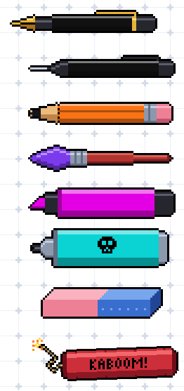</td>
<td>

Cada ferramenta **guarda a sua própria cor, tamanho e opacidade**, e o desenho dela na barra é pintado com a cor escolhida, com brilho e sombra. Assim você sabe na hora o que cada uma vai desenhar.

Todas as ferramentas são **pixel-art desenhada pixel a pixel** na mesma grade, assim como o fundo quadriculado, para tudo parecer saído do mesmo videogame.

| Ferramenta | Como desenha |
| :-- | :-- |
| 🖊️ **Caneta** | traço firme e contínuo |
| ✒️ **Caneta fina** | contornos e detalhes |
| ✏️ **Lápis** | traço firme, com som granulado de grafite |
| 🖌️ **Pincel** | fica mais grosso com a pressão (em mesa digitalizadora) |
| 🖍️ **Marcador** | translúcido, ótimo para pintar por cima |
| 💨 **Spray** | nuvem de pontinhos |
| 🧽 **Borracha** | apaga só a camada atual |
| 🧨 **KABOOM!** | explode tudo da camada atual (com som e tela tremendo) |

**Clique uma vez** para escolher a ferramenta. **Clique de novo** para abrir as opções dela.

</td>
</tr>
</table>

<div align="center">
  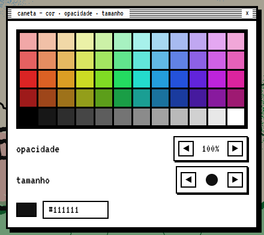
  <br><sub>Paleta de 60 cores, 4 níveis de opacidade, 6 tamanhos e um campo para digitar qualquer cor em código (ex.: <code>#e400e4</code>).</sub>
</div>

### Camadas, como nos programas profissionais

<table>
<tr>
<td>

Separe o seu desenho em partes (céu, chão, personagem) e mexa em uma sem estragar as outras.

- **＋** cria uma camada nova logo acima da atual
- **◉** mostra ou esconde a camada
- **arrastar** muda a ordem das camadas
- **⋮** abre as opções: opacidade, renomear, duplicar, bloquear e apagar
- Uma camada **bloqueada** não aceita traços; ela treme para avisar

</td>
<td width="260" align="center">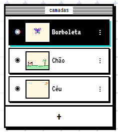</td>
</tr>
</table>

### Espelho: desenhe um lado e ganhe o outro

Ligue o espelho **horizontal**, o **vertical** ou os dois ao mesmo tempo (botões acima do quadro). Tudo o que você desenha é copiado do outro lado. É ótimo para borboletas, rostos, mandalas e logotipos.

<div align="center">
  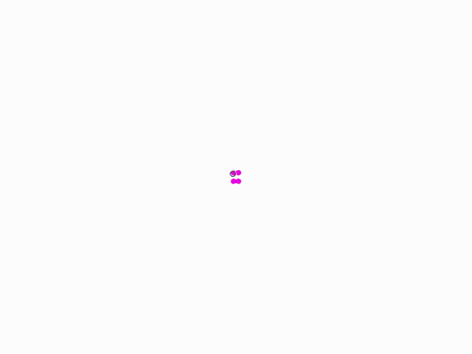
</div>

### Formas, fundo e tamanho da tela

<table>
<tr>
<td width="50%" valign="top">

**▢ ◯ ╱ Formas:** retângulo, elipse e linha, também com o efeito tremido. Cada forma tem cor e espessura próprias.

**Background:** escolha a cor de fundo do quadro a qualquer momento.

**Crop:** troque o formato da tela (paisagem, quadrado, retrato ou wide) ou **recorte uma área**. É só arrastar sobre o desenho para manter apenas aquele pedaço.

</td>
<td width="50%" align="center">
  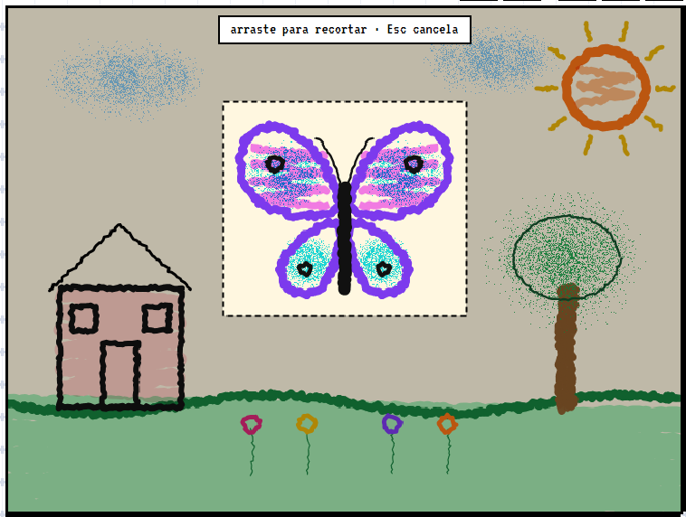
</td>
</tr>
</table>

### Salve, exporte e compartilhe

<table>
<tr>
<td width="50%" valign="top">

- **Salvar** guarda o projeto no próprio navegador (com as camadas e tudo)
- **Exportar → GIF animado** gera um GIF com o desenho tremendo, pronto para mandar no WhatsApp, Discord ou redes sociais
- **Exportar → Imagem PNG** gera uma imagem parada
- Se você tentar sair com alterações não salvas, o RetroBit **pergunta antes** de descartar

</td>
<td width="50%" align="center">
  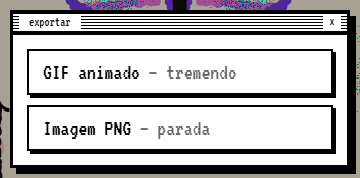
</td>
</tr>
</table>

### Galeria de projetos

Todos os seus desenhos ficam numa galeria com miniaturas. O botão **✎** de cada miniatura serve para renomear ou excluir.

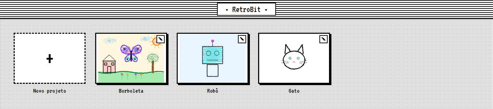

> [!NOTE]
> Os projetos ficam salvos **neste navegador, neste computador** (no `localStorage`). Se você limpar os dados do navegador ou abrir em outro computador, eles não estarão lá. Para guardar um desenho para sempre, use **Exportar**.

<br>

<a id="atalhos"></a>

## ⌨️ Atalhos de teclado

| Atalho | O que faz |
| :-- | :-- |
| <kbd>Ctrl</kbd> + <kbd>Z</kbd> | desfazer |
| <kbd>Ctrl</kbd> + <kbd>Y</kbd> ou <kbd>Ctrl</kbd> + <kbd>Shift</kbd> + <kbd>Z</kbd> | refazer |
| <kbd>Ctrl</kbd> + <kbd>S</kbd> | salvar |
| <kbd>Esc</kbd> | fechar janelas / cancelar o recorte |

> No Mac, use <kbd>⌘ Cmd</kbd> no lugar de <kbd>Ctrl</kbd>.

<br>

<a id="codigo"></a>

## 🧠 Por dentro do código

> Esta parte é para quem quer entender ou mexer no código.

O RetroBit é feito com **HTML, CSS e JavaScript puros** (ES Modules), **sem nenhuma biblioteca**, sem build e sem `npm install`. Até o gerador de GIF e os sons foram escritos do zero.

### As ideias principais

**1. O desenho é guardado como traços, não como pixels.**
Cada traço é uma lista de pontos com ferramenta, cor e tamanho. Por isso o desenho pode ser redesenhado tremendo, ser redimensionado sem perder qualidade e ter "desfazer" sem gastar muita memória.

**2. O tremor é previsível.**
O deslocamento de cada ponto é calculado por uma função pseudoaleatória de `(x, y, quadro)`, então os mesmos valores dão sempre o mesmo resultado. O tremor só muda de quadro a cerca de 12 vezes por segundo, o que dá o ar retrô. Já o traço que você está fazendo é redesenhado a 60 fps, então a mão nunca sente atraso.

```js
// js/wiggle.js
export function wob(x, y, frame) {
  const s = Math.sin(x * 12.9898 + y * 78.233 + frame * 0.7) * 43758.5453;
  return (s - Math.floor(s)) * 2 - 1; // sempre o mesmo valor para os mesmos (x, y, frame)
}
```

**3. Cada camada tem o seu próprio "rascunho".**
As camadas são desenhadas em canvases separados, guardados em cache e só refeitos quando o tremor muda de quadro. É isso que faz a borracha apagar apenas a camada atual e o marcador se misturar só dentro da própria camada.

### Como as peças se conectam

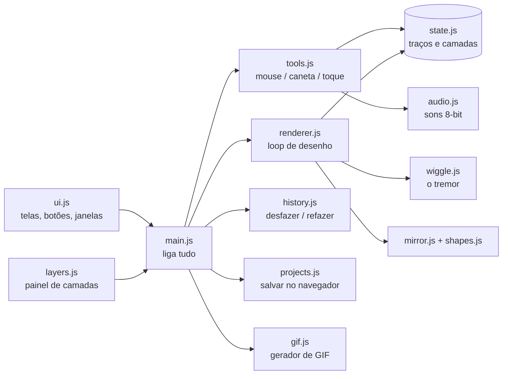

### Estrutura de pastas

```text
RetroBit/
├── index.html          → estrutura das telas e janelas
├── styles.css          → todo o visual 1-bit
├── assets/
│   ├── favicon.svg     → ícone da aba
│   └── tools/          → sprites pixel-art das ferramentas e da dinamite KABOOM!
│       └── legacy/     → arte original das ferramentas (versão anterior)
├── scripts/
│   └── pixel-sprites.py → gera os sprites pixel-art (Python + Pillow)
├── docs/images/        → imagens deste README
└── js/
    ├── main.js         → ponto de entrada: conecta todos os módulos
    ├── state.js        → estado global, ferramentas e camadas
    ├── tools.js        → o que acontece ao clicar/arrastar no quadro
    ├── renderer.js     → loop de desenho com cache por camada
    ├── engine.js       → canvas principal, sobreposição e explosão
    ├── wiggle.js       → função do tremor e densificação dos traços
    ├── mirror.js       → cálculo do espelho
    ├── shapes.js       → retângulo, elipse e linha
    ├── layers.js       → painel de camadas
    ├── history.js      → desfazer / refazer
    ├── projects.js     → galeria e salvamento (localStorage)
    ├── gif.js          → codificador GIF89a feito à mão
    ├── audio.js        → sons sintetizados com Web Audio (sem arquivos de som)
    ├── tool-art.js     → pinta os desenhos das ferramentas com a cor escolhida
    ├── theme.js        → cores do tema
    └── util.js         → utilitários (ex.: escapar texto em HTML)
```

### Detalhes que valem a pena conhecer

- **Sons 100% sintetizados:** cada ferramenta tem o seu "som de riscar", feito com ruído filtrado, que fica mais alto quanto mais rápido você desenha. O botão **♪** liga e desliga o som, e o app lembra da sua escolha.
- **GIF sem bibliotecas:** o `gif.js` escreve o formato GIF89a byte a byte, com uma paleta fixa de 216 cores.
- **Sprites gerados por código:** cada ferramenta é uma grade de 72×22 pixels descrita em [`scripts/pixel-sprites.py`](scripts/pixel-sprites.py), que o app amplia 3×. O branco vira a cor escolhida e dois cinzas especiais viram brilho e sombra. Para mudar um desenho, edite o script e rode `python scripts/pixel-sprites.py` (precisa do Pillow: `pip install pillow`).
- **Pressão da caneta:** o pincel e o spray reagem à pressão de mesas digitalizadoras (Pointer Events).
- **Toque:** aceita dedo e caneta. Só um ponteiro desenha de cada vez, para um segundo dedo não atrapalhar.

<br>

## 🌐 Navegadores

Feito para navegadores modernos e testado no **Google Chrome**. Os navegadores atuais baseados nos mesmos padrões (Edge, Firefox, Safari) devem funcionar igual. A interface foi pensada para **telas grandes** (notebook, desktop ou tablet na horizontal).

<br>

## 💜 Créditos

Desenvolvido por **[Nicolas Vieira](https://github.com/Nickvtj)**.

- Inspirado no charme dos programas de desenho *wiggly* e dos computadores 1-bit
- Fontes: [VT323](https://fonts.google.com/specimen/VT323) e [Covered By Your Grace](https://fonts.google.com/specimen/Covered+By+Your+Grace), do Google Fonts

<div align="center">
<br>
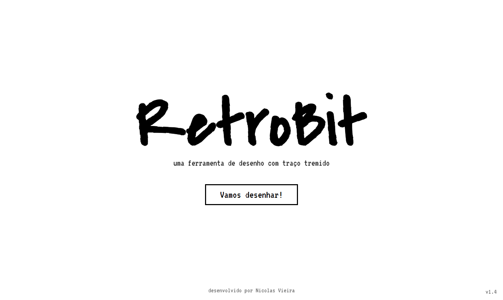
<br><br>
<sub>Feito com traços tremidos e muito ♥</sub>
</div>
