<div align="center">

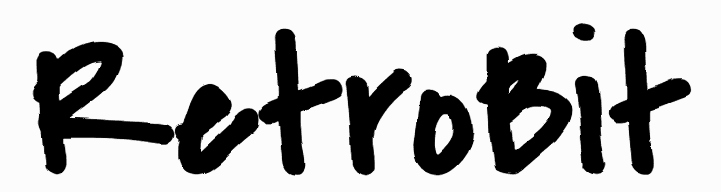

### Uma ferramenta de desenho onde cada traço fica *vivo*.

Desenhe com canetas, pincéis e spray, e veja o desenho tremer como num desenho animado antigo. Depois, exporte tudo como um **GIF animado**.

<br>


[**Como usar**](#como-usar) ·
[**Funcionalidades**](#funcionalidades) ·
[**Atalhos**](#atalhos) ·
[**Por dentro do código**](#codigo)

<br>

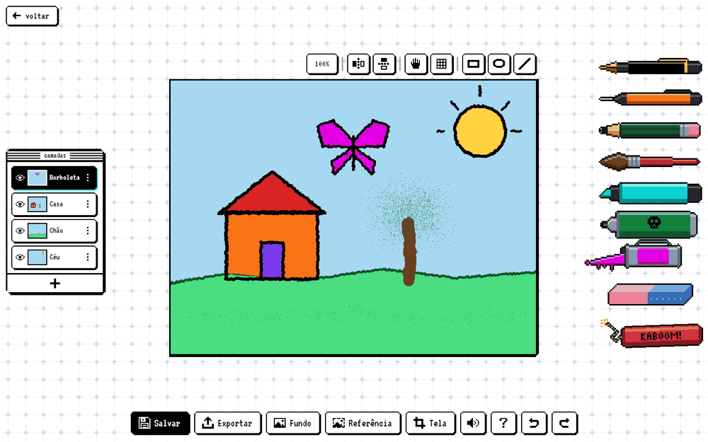

</div>

<br>

## ✏️ O que é o RetroBit?

O RetroBit é um programa de desenho que roda **direto no navegador**. Não precisa instalar nada e não precisa de internet depois de aberto.

O que o deixa diferente é o **traço tremido**: tudo o que você desenha fica se mexendo de leve, sem parar, como nos desenhos feitos à mão em que cada quadro é redesenhado. O visual lembra os computadores dos anos 80, com fonte pixelada, janelas em preto e branco e sons de videogame antigo.

<div align="center">
  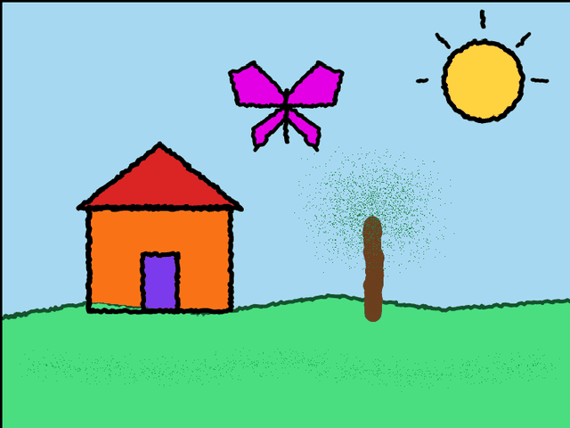
  <br><sub>Nada de filtro: cada traço é redesenhado com um pequeno tremor 12 vezes por segundo.</sub>
</div>

<br>

<a id="como-usar"></a>

## 🚀 Como abrir no seu computador

O RetroBit é só um site, sem nada para instalar ou compilar. Você só precisa de um **servidor local**, porque o navegador não carrega os arquivos do programa se você der dois cliques no `index.html`.

**1. Baixe o projeto**

```bash
git clone https://github.com/Nickvtj/CyberPaint.git
cd CyberPaint
```

> Sem Git? No GitHub, clique em **Code → Download ZIP** e descompacte.

**2. Ligue um servidor local** (escolha **uma** opção)

| Você tem… | Faça isto |
| :-- | :-- |
| **Python** | `python -m http.server 8000` <br><sub>(no macOS/Linux pode ser `python3`)</sub> |
| **Node.js** | `npx serve -l 8000 .` |
| **VS Code** | instale a extensão **Live Server**, clique com o botão direito no `index.html` e escolha **Open with Live Server** (ele abre o navegador sozinho) |

**3. Abra no navegador:** [`http://localhost:8000`](http://localhost:8000) e clique em **Vamos desenhar!**

<br>

<a id="funcionalidades"></a>

## 🎨 O que dá para fazer

### Oito ferramentas, cada uma com a sua cor

<table>
<tr>
<td width="230" align="center">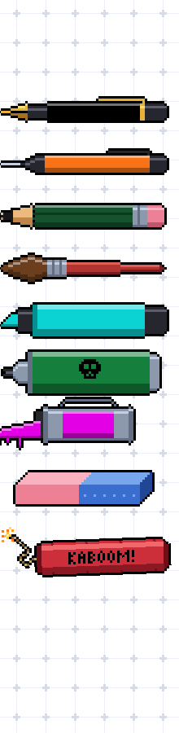</td>
<td>

Cada ferramenta **guarda a sua própria cor, tamanho e opacidade**, e o desenho dela na barra é pintado com a cor escolhida, com brilho e sombra. Assim você sabe na hora o que cada uma vai desenhar.

Todas as ferramentas são **pixel-art desenhada pixel a pixel** na mesma grade, assim como o fundo quadriculado, para tudo parecer saído do mesmo videogame.

| Ferramenta | Como desenha |
| :-- | :-- |
| 🖊️ **Caneta** | traço firme e contínuo |
| ✒️ **Caneta fina** | contornos e detalhes |
| ✏️ **Lápis** | traço firme, com som granulado de grafite |
| 🖌️ **Pincel** | fica mais grosso com a pressão (em mesa digitalizadora) |
| 🖍️ **Marcador** | translúcido, ótimo para pintar por cima |
| 💨 **Spray** | nuvem de pontinhos |
| 🪣 **Balde** | pinta uma área inteira até encontrar uma "parede" |
| 🧽 **Borracha** | apaga só a camada atual |
| 🧨 **KABOOM!** | o pavio arde e tudo da camada atual explode (com som e tela tremendo) |

**Clique uma vez** para escolher a ferramenta. **Clique de novo** para abrir o **menu rápido** dela, que aparece ao lado da caneta: 6 cores favoritas, tamanho, opacidade e a paleta completa, sem janela para fechar depois.

**Segure** um quadradinho das favoritas (ou clique com o botão direito) para guardar nele a cor atual. O **conta-gotas** pega qualquer cor da tela: pelo botão do menu, com <kbd>Alt</kbd> + clique ou segurando o dedo parado sobre a tela.

</td>
</tr>
</table>

<div align="center">
  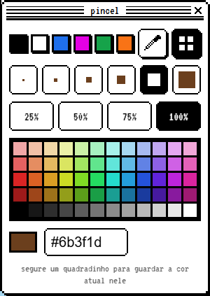
  <br><sub>Paleta de 60 cores, 4 níveis de opacidade, 6 tamanhos e um campo para digitar qualquer cor em código (ex.: <code>#e400e4</code>), tudo no menu rápido.</sub>
</div>

### Camadas, como nos programas profissionais

<table>
<tr>
<td>

Separe o seu desenho em partes (céu, chão, personagem) e mexa em uma sem estragar as outras.

- **＋** cria uma camada nova logo acima da atual
- **◉** mostra ou esconde a camada
- **arrastar** muda a ordem das camadas
- **⋮** abre as opções: opacidade, renomear, duplicar, bloquear e apagar
- Uma camada **bloqueada** não aceita traços; ela treme para avisar

</td>
<td width="260" align="center">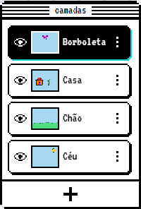</td>
</tr>
</table>

### Balde de tinta

Clique dentro de uma área e ela é pintada até encontrar uma cor diferente, que serve de parede. Desenhe um quadrado, um círculo ou um coração com qualquer caneta, clique dentro e o interior fica preenchido.

- **Troca rápida de cor:** clique de novo com outra cor em cima de uma área já pintada e ela muda na hora. Clique em cima de um **traço** e só a cor dele muda.
- **Arrastar e soltar:** arraste a lata de tinta (ou uma cor do menu rápido do balde) até a tela e solte onde quer pintar. A tinta se espalha a partir dali.
- O balde enxerga **todas as camadas visíveis**, mas pinta só na camada ativa, por baixo das linhas. Assim as linhas continuam tremendo sem abrir frestas brancas.

<div align="center">
  
</div>

### A luva: pegar, mover, esticar e girar

Ligue a **luva** (botão da mão, acima da tela) e toque num traço para pegá-lo, ou arraste no vazio para pegar vários de uma vez.

- **Arrastar** move. Os **quadradinhos piscando** nos cantos esticam (com <kbd>Shift</kbd>, sem deformar). A **alça de cima** gira (com <kbd>Shift</kbd>, de 15 em 15°).
- A barrinha embaixo da seleção **explode**, **duplica** ou **espelha** o que foi pego.
- No **modo bomba** (canto da tela), cada toque num traço faz ele explodir em pixels.
- A borracha não pode ser pega: ela apaga o que estiver por baixo dela.

<div align="center">
  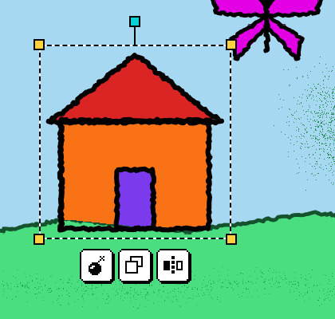
</div>

### Imagem de referência

Em **Referência**, escolha uma foto ou desenho (ou arraste o arquivo para a tela, ou cole com <kbd>Ctrl</kbd> + <kbd>V</kbd>) para desenhar por cima. Dá para mudar a opacidade, esconder, deixar por cima do desenho, ver em preto e branco, mover e esticar. A referência **não sai** no GIF, no PNG nem na miniatura da galeria, e o balde a ignora. O conta-gotas, por outro lado, pega cores dela.

### Grade de pixel art

O botão da **grade** (acima da tela) liga uma grade de 8, 16 ou 32 px. Com ela ligada, as canetas pintam **quadradinhos** (o tamanho da caneta escolhe blocos de 1, 2 ou 3 células), a borracha apaga quadradinhos e as formas se encaixam nas linhas. Os cantos de cada quadradinho também tremem, então a pixel art fica viva como o resto. A grade não aparece na exportação.

<div align="center">
  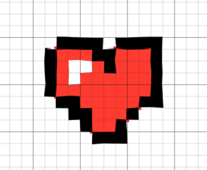
</div>

### Espelho: desenhe um lado e ganhe o outro

Ligue o espelho **horizontal**, o **vertical** ou os dois ao mesmo tempo (botões acima do quadro). Tudo o que você desenha é copiado do outro lado. É ótimo para borboletas, rostos, mandalas e logotipos.

<div align="center">
  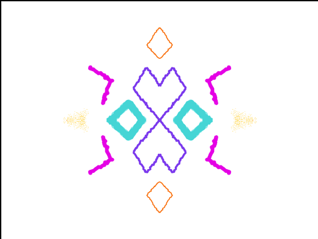
</div>

### Formas, fundo e tamanho da tela

<table>
<tr>
<td width="50%" valign="top">

**▢ ◯ ╱ Formas:** retângulo, elipse e linha, também com o efeito tremido. Cada forma tem cor e espessura próprias.

**Fundo:** escolha a cor de fundo do quadro a qualquer momento.

**Tela:** troque o formato da tela (paisagem, quadrado, retrato ou wide) ou **recorte uma área**. É só arrastar sobre o desenho para manter apenas aquele pedaço.

</td>
<td width="50%" align="center">
  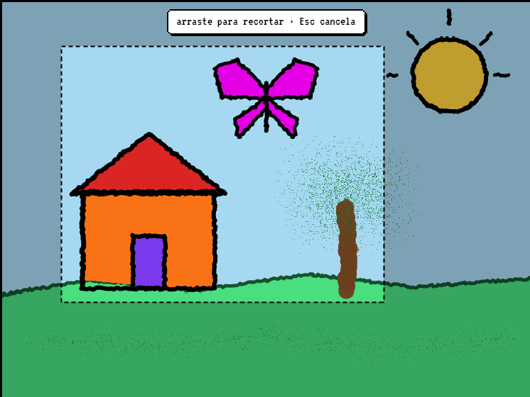
</td>
</tr>
</table>

### Salve, exporte e compartilhe

<table>
<tr>
<td width="50%" valign="top">

- **Salvar** guarda o projeto no próprio navegador (com as camadas e tudo)
- **Exportar → GIF animado** gera um GIF leve com o desenho tremendo, pronto para mandar no WhatsApp, Discord ou redes sociais. **GIF grande** sai no tamanho original
- **Exportar → Imagem PNG** gera uma imagem parada; **PNG sem fundo** sai com o fundo transparente (ótimo para figurinhas)
- **Exportar → Arquivo do projeto** baixa um `.retrobit`: um backup completo, com camadas e referência. Para abrir em outro navegador ou aparelho, use **Abrir arquivo** na galeria (ou arraste o arquivo para ela)
- Se você tentar sair ou fechar a aba com alterações não salvas, o RetroBit **pergunta antes** de descartar
- Se a aba fechar sem querer, o desenho é **recuperado** na próxima vez que você abrir o RetroBit

</td>
<td width="50%" align="center">
  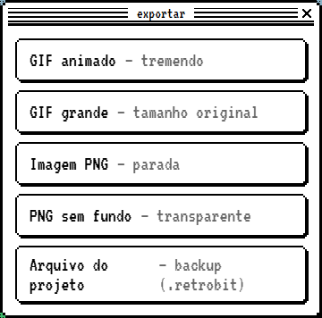
</td>
</tr>
</table>

### Galeria de projetos

Todos os seus desenhos ficam numa galeria com miniaturas. O botão **✎** de cada miniatura serve para renomear ou excluir.

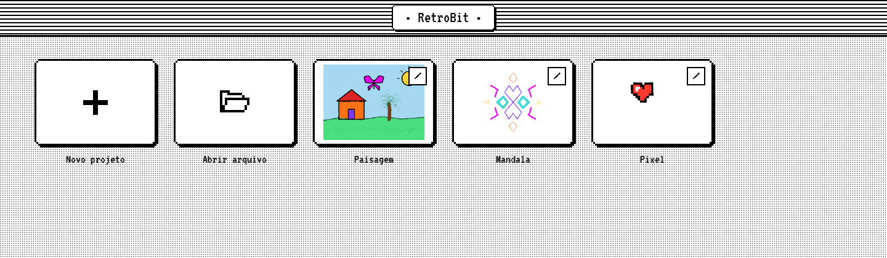

### Primeira vez? Tem tutorial

Na primeira vez que você abre a tela de desenho, um tutorial rápido mostra cada parte. Para ver de novo, use o botão **?** (Ajuda). O RetroBit fala **português e inglês**: ele segue a língua do navegador, e o botão no canto da tela inicial troca.

> [!NOTE]
> Os projetos ficam salvos **neste navegador, neste computador** (no `IndexedDB`). Se você limpar os dados do navegador ou abrir em outro computador, eles não estarão lá. Para guardar um desenho para sempre, use **Exportar**.

<br>

<a id="atalhos"></a>

## ⌨️ Atalhos de teclado

| Atalho | O que faz |
| :-- | :-- |
| <kbd>Ctrl</kbd> + <kbd>Z</kbd> | desfazer |
| <kbd>Ctrl</kbd> + <kbd>Y</kbd> ou <kbd>Ctrl</kbd> + <kbd>Shift</kbd> + <kbd>Z</kbd> | refazer |
| <kbd>Ctrl</kbd> + <kbd>S</kbd> | salvar |
| <kbd>Ctrl</kbd> + <kbd>V</kbd> | colar uma imagem como referência |
| <kbd>Delete</kbd> (com a luva) | explodir o que está pego |
| setas (com a luva) | mover o que está pego 1 px (com <kbd>Shift</kbd>, 10 px) |
| <kbd>Ctrl</kbd> + <kbd>D</kbd> / <kbd>Ctrl</kbd> + <kbd>A</kbd> (com a luva) | duplicar / pegar tudo da camada |
| <kbd>Esc</kbd> | fechar janelas e menus / cancelar o recorte ou o conta-gotas |
| <kbd>Alt</kbd> + clique na tela | conta-gotas |
| <kbd>Ctrl</kbd> + roda do mouse (ou pinça no trackpad) | zoom |
| roda do mouse · <kbd>Espaço</kbd> + arrastar · botão do meio | mover a tela ampliada |
| <kbd>+</kbd> / <kbd>-</kbd> / <kbd>0</kbd> | mais zoom / menos zoom / voltar a 100% |

> No Mac, use <kbd>⌘ Cmd</kbd> no lugar de <kbd>Ctrl</kbd>.

### No tablet e no celular

| Gesto | O que faz |
| :-- | :-- |
| 1 dedo | desenha |
| pinça com 2 dedos | zoom |
| arrastar com 2 dedos | mover a tela |
| tocar rápido com 2 dedos | desfazer |
| tocar rápido com 3 dedos | refazer |
| segurar o dedo parado | conta-gotas |

Com uma **caneta digital** (Apple Pencil, S Pen…), o dedo não desenha: ele só move a tela, então a palma da mão não deixa marcas.

<br>

<a id="codigo"></a>

## 🧠 Por dentro do código

> Esta parte é para quem quer entender ou mexer no código.

O RetroBit é feito com **HTML, CSS e JavaScript puros** (ES Modules), **sem nenhuma biblioteca**, sem build e sem `npm install`. Até o gerador de GIF e os sons foram escritos do zero.

### As ideias principais

**1. O desenho é guardado como traços, não como pixels.**
Cada traço é uma lista de pontos com ferramenta, cor e tamanho. Por isso o desenho pode ser redesenhado tremendo, ser redimensionado sem perder qualidade e ter "desfazer" sem gastar muita memória.

**2. O tremor é previsível.**
O deslocamento de cada ponto é calculado por uma função pseudoaleatória de `(x, y, quadro)`, então os mesmos valores dão sempre o mesmo resultado. O tremor só muda de quadro a cerca de 12 vezes por segundo, o que dá o ar retrô, e alterna entre **3 quadros**, como as linhas "fervendo" dos desenhos animados. Já o traço que você está fazendo é redesenhado a 60 fps, então a mão nunca sente atraso.

```js
// js/wiggle.js
export function wob(x, y, frame) {
  const s = Math.sin(x * 12.9898 + y * 78.233 + frame * 0.7) * 43758.5453;
  return (s - Math.floor(s)) * 2 - 1; // sempre o mesmo valor para os mesmos (x, y, frame)
}
```

**3. Cada camada tem o seu próprio "rascunho".**
As camadas são desenhadas em canvases separados, um para cada quadro do tremor, guardados em cache e só refeitos quando a camada muda. Com a tela parada, o programa só copia imagens prontas. É isso que faz a borracha apagar apenas a camada atual e o marcador se misturar só dentro da própria camada.

### Como as peças se conectam

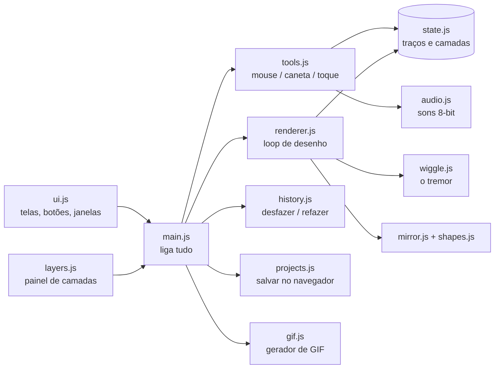

### Estrutura de pastas

```text
RetroBit/
├── index.html          → estrutura das telas e janelas
├── styles.css          → todo o visual 1-bit e os layouts (desktop, tablet, celular)
├── manifest.webmanifest → dados do app instalável (PWA)
├── sw.js               → service worker: funciona offline
├── assets/
│   ├── favicon.svg     → ícone da aba
│   ├── icons/          → ícones do app instalado (gerados por scripts/app-icons.py)
│   ├── fonts/          → fontes VT323 e Covered By Your Grace (licença SIL OFL)
│   └── tools/          → sprites pixel-art das ferramentas e da dinamite KABOOM!
│       └── legacy/     → arte original das ferramentas (versão anterior)
├── scripts/
│   ├── pixel-sprites.py → gera os sprites pixel-art (Python + Pillow)
│   ├── app-icons.py    → gera os ícones do app a partir do favicon
│   ├── readme-images.py → desenha no app e gera as imagens deste README
│   └── smoke-test.py   → teste rápido de ponta a ponta (antes de publicar)
├── docs/images/        → imagens deste README
└── js/
    ├── main.js         → ponto de entrada: conecta todos os módulos
    ├── state.js        → estado global, ferramentas e camadas
    ├── tools.js        → o que acontece ao clicar/arrastar no quadro
    ├── renderer.js     → loop de desenho com cache por camada
    ├── engine.js       → canvas principal, sobreposição e explosão
    ├── wiggle.js       → função do tremor e densificação dos traços
    ├── mirror.js       → cálculo do espelho
    ├── shapes.js       → retângulo, elipse e linha
    ├── layers.js       → painel de camadas (arrastar para reordenar)
    ├── quick-menu.js   → menu rápido de cor, tamanho e opacidade
    ├── viewport.js     → zoom, mover a tela e gestos de toque
    ├── icons.js        → ícones pixel-art da interface (desenhados em texto)
    ├── palette.js      → paleta de 60 cores
    ├── fill.js         → balde: região a pintar e máscaras compactas
    ├── paint-drag.js   → arrastar a tinta do balde até a tela
    ├── hit.js          → "qual traço está debaixo do dedo?"
    ├── select.js       → a luva (selecionar, mover, esticar, girar, explodir)
    ├── transform.js    → contas de mover / esticar / girar traços
    ├── reference.js    → imagem de referência
    ├── fx.js           → partículas, animações das ferramentas e o pavio da dinamite
    ├── tour.js         → tutorial da primeira vez
    ├── i18n.js         → português e inglês
    ├── version.js      → número da versão
    ├── history.js      → desfazer / refazer
    ├── projects.js     → galeria, salvamento e rascunho automático (IndexedDB)
    ├── gif.js          → codificador GIF89a feito à mão
    ├── audio.js        → sons sintetizados com Web Audio (sem arquivos de som)
    ├── tool-art.js     → pinta os desenhos das ferramentas com a cor escolhida
    ├── theme.js        → cores do tema
    └── util.js         → utilitários (ex.: escapar texto em HTML)
```

### Detalhes que valem a pena conhecer

- **Sons 100% sintetizados:** cada ferramenta tem o seu "som de riscar" (o *tic* da caneta, o grafite granulado do lápis, o *psss* pulsado do spray, o rangido da borracha…), que fica mais alto quanto mais rápido você desenha. Com a grade ligada, cada quadradinho toca uma nota. Abrir janelas, salvar, desfazer, criar camadas, escolher cores e explodir também têm som. Tudo passa por um compressor, então nada estoura. O botão **Som** liga e desliga, e o app lembra da sua escolha.
- **Cursores pixel-art:** seta, mão apontando, mão apertando, texto, mira, lata de tinta, conta-gotas, cadeado (camada bloqueada), ampulheta (gerando o GIF), luva e bomba. O círculo do pincel também é desenhado em pixels.
- **Ferramentas vivas:** ao escolher uma ferramenta, ela reage com uma animação própria e solta partículas pixel-art da ponta (gotas, lascas de lápis, respingos, nuvem de spray, farelos de borracha). Passe o mouse na dinamite para ver as faíscas no pavio. Quem ativa "reduzir movimento" no sistema não vê partículas nem animações.
- **GIF sem bibliotecas:** o `gif.js` escreve o formato GIF89a byte a byte, com uma paleta de até 256 cores tirada do próprio desenho e compressão LZW. Um desenho típico vira um GIF de poucos KB.
- **Sprites gerados por código:** cada ferramenta é uma grade de 72×22 pixels descrita em [`scripts/pixel-sprites.py`](scripts/pixel-sprites.py), que o app amplia 3×. O branco vira a cor escolhida e dois cinzas especiais viram brilho e sombra. Para mudar um desenho, edite o script e rode `python scripts/pixel-sprites.py` (precisa do Pillow: `pip install pillow`).
- **Pressão da caneta:** o pincel e o spray reagem à pressão de mesas digitalizadoras (Pointer Events).
- **Toque:** aceita dedo e caneta. Só um ponteiro desenha de cada vez; um segundo dedo vira gesto (zoom, mover, desfazer).
- **Balde sem frestas:** a área é calculada sobre o desenho "parado" (sem tremor) e cresce 3 px por baixo das linhas que a fecham. Como é desenhada por baixo do resto da camada, a linha pode tremer à vontade sem mostrar o branco.
- **Cursores pixel-art:** a luva, a mão fechada e a bomba são desenhadas em texto em [`js/icons.js`](js/icons.js) e viram cursores SVG.
- **Ícones em texto:** cada ícone da interface é uma grade de 12×12 escrita com `#` em [`js/icons.js`](js/icons.js) e vira um SVG nítido em qualquer tamanho.
- **Molduras pixeladas:** todas as janelas e botões usam a mesma moldura de cantos em degrau (`border-image` em SVG), com uma sombra dura que segue os degraus.

<br>

## 🌐 Navegadores e aparelhos

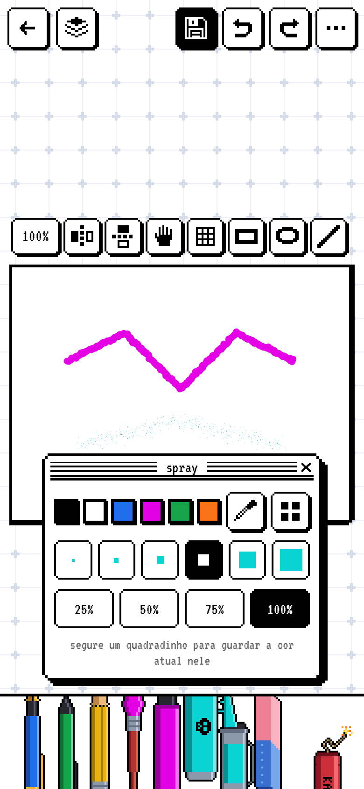

Feito para navegadores modernos e testado no **Google Chrome**. Os navegadores atuais baseados nos mesmos padrões (Edge, Firefox, Safari) devem funcionar igual.

A interface se adapta ao tamanho da tela: **desktop e notebook**, **tablet** deitado ou em pé (as canetas viram uma bandeja embaixo) e **celular** deitado ou em pé (as camadas viram uma gaveta e as ações extras ficam no menu **⋯**). No celular ou tablet, use **Adicionar à tela inicial** para instalar o RetroBit como um app que funciona offline. No **celular em pé**, o RetroBit sugere virar de lado: na horizontal a tela de desenho fica maior e todas as canetas ficam à vista (no Android, o botão **Tela cheia deitada** já entra em tela cheia na horizontal). Quem preferir desenhar em pé é só tocar em **Continuar em pé**.

<br>

## 🚢 Publicar

O RetroBit é um site estático: qualquer hospedagem serve. No **GitHub Pages**, vá em *Settings → Pages*, escolha a branch `main` e a pasta `/ (root)`. Em um minuto o site fica no ar com HTTPS, e aí ele pode ser **instalado** no celular e no computador.

Antes de cada versão nova:

1. Suba o número em [`js/version.js`](js/version.js) e o nome da cache em [`sw.js`](sw.js)
2. Rode o teste rápido: `python scripts/smoke-test.py`
3. Se a interface mudou, refaça as imagens: `python scripts/readme-images.py`

> As tags de compartilhamento (`og:image`) usam um caminho relativo. Depois de publicar, troque por o endereço completo de `docs/images/social.png` para a prévia aparecer no WhatsApp e no Discord.

<br>

## 💜 Créditos

Desenvolvido por **[Nicolas Vieira](https://github.com/Nickvtj)**.

- Inspirado no charme dos programas de desenho *wiggly* e dos computadores 1-bit
- Fontes: [VT323](https://fonts.google.com/specimen/VT323) e [Covered By Your Grace](https://fonts.google.com/specimen/Covered+By+Your+Grace), sob a licença SIL Open Font License (incluídas em `assets/fonts/`)

<div align="center">
<br>
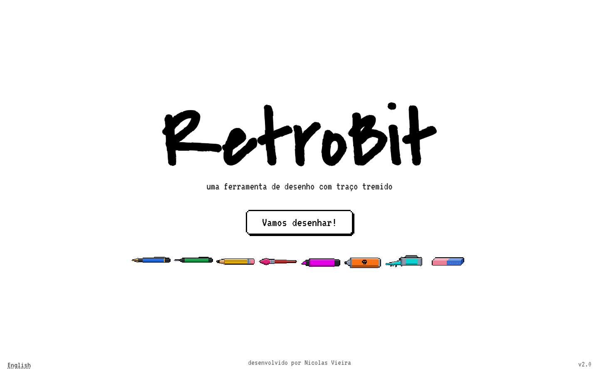
<br><br>
<sub>Feito com traços tremidos e muito ♥</sub>
</div>
